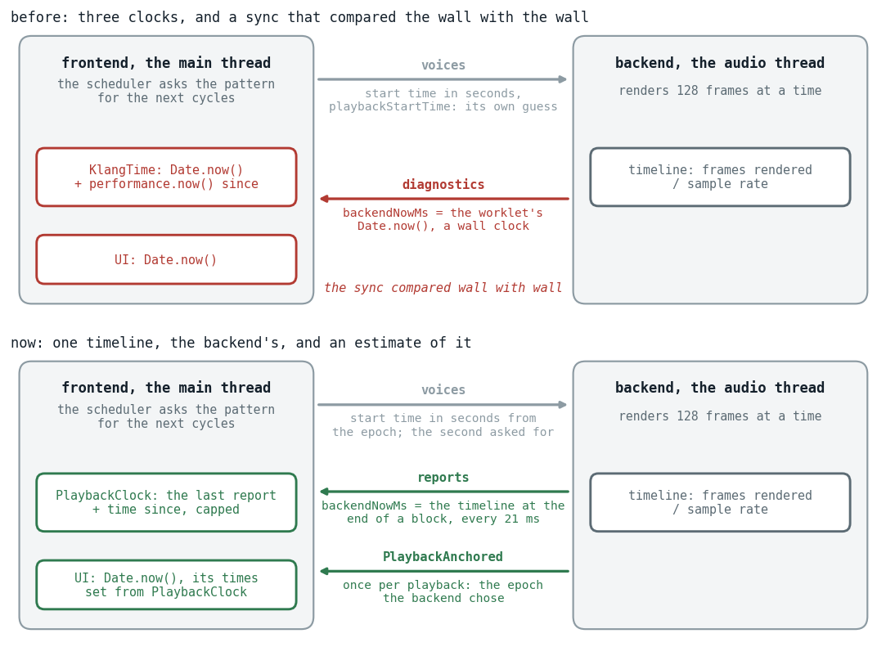
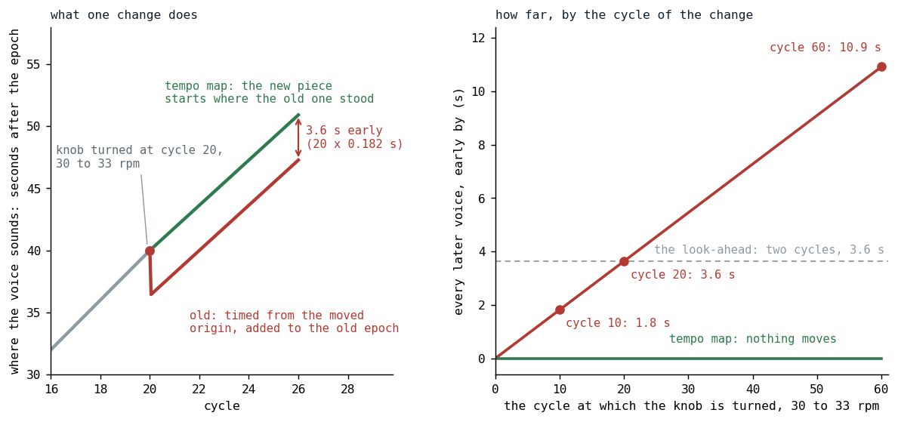
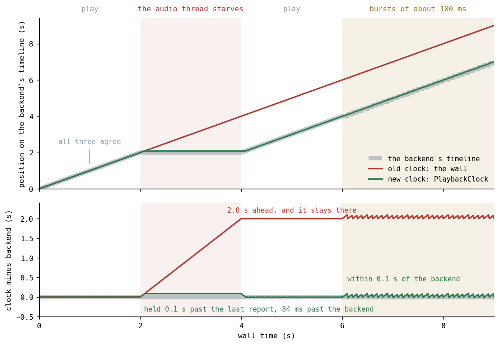

# The Handshake Seals the Contract

*One timeline counted in the backend's own frames, a handshake that says where a playback starts, and a backend that renders only when told.*

Klang, a live-coding music system, plays a song in two places at once. The sound is made in the backend, on an audio thread (in the browser, an AudioWorklet) that renders 128 frames at a time. The notes come from the frontend, on the main thread, where a scheduler asks the song's pattern what happens next and sends each note across as a *voice*: what to play, and when, in seconds from the start of its *playback*, one running song whose second 0 is its *epoch*. For a voice to sound where it was meant to, the two sides have to agree on what time it is ([Policy of Truth](../2026-06-07-sixty-seven-microseconds-to-385-nanoseconds/index.md) is another post, about how the messages cross). For a long time they agreed most of the time.

On October 31 the maintainer wrote down the cases where they did not:

- **A tempo change** in a long song went wrong, and the longer the song had played, the worse.
- **Closing the laptop** and opening it again "forces a page reload as frontend and backend are hopelessly out of sync".
- **A phone that stutters**, where "the next voices are 'lost' or only half cycles are played".

Then came a direction, which became the design: "When the backend starts to stutter and misses frames, the frontend clock runs away. So we need to somehow update the frontend clock from the number of frames that were processed by the backend. So no wall clock there, or only to calculate the difference between the last sync with the backend." The title borrows the first line of Depeche Mode's "Everything Counts" [[1]](#depeche-mode).

## Three clocks, and a sync that compared wall with wall

Before this work a playback ran on three clocks (Fig. 1): the frontend's `KlangTime` (`Date.now()` at its creation plus `performance.now()` since), the backend's timeline (it advances with the frames rendered), and the UI's plain `Date.now()`, which times the code highlights and the voice rain (voices falling down the screen).



*Fig. 1: The two threads, what crosses between them and the clocks each side reads. A sketch, not data. Crimson marks a wall clock; the lower half is the state now. The UI still reads `Date.now()`; what changed is where its times are set from. Reports and `PlaybackAnchored` are met below.*

Between the first two sat `BackendClockSync`, an earlier try at this very problem, a smoothed average of the backend's time less the frontend's. But the backend's regular report, its diagnostics message, carried "the backend's time" as `backendNowMs`, and the dispatcher filled that from the worklet's `Date.now()`:

```kotlin
backendNowMs = endMs,
```

*[PlaybackEngineDispatcher.kt, the line as it was](https://github.com/PeekAndPoke/klang/blob/bef558a7c/audio_be/src/commonMain/kotlin/PlaybackEngineDispatcher.kt#L277)*

So the sync compared a wall clock with a wall clock. A backend that rendered half the frames it should went on reporting a healthy `Date.now()`, and nothing on the frontend could see it fall behind. The ticket (KLANG-00399) counts eleven problems, most with that one cause; three of them are the maintainer's cases, in his order, as we read them in the code.

**A tempo change moved the wrong origin.** Say 30 rpm (cycles per minute, a cycle being the pattern's unit of time), 2.000 s a cycle, and the knob goes to 33 rpm, 1.818 s a cycle, at cycle N. The frontend moved its idea of second 0 so that the current cycle kept its place in time; the backend's epoch stayed, and it counts every voice from there. Every voice sent after the change landed N times 0.182 s early: 1.8 s at cycle 10, 3.6 s at cycle 20, 10.9 s at cycle 60 (Fig. 2). From about cycle 20, where the shift outgrows the look-ahead (the two cycles the scheduler sends ahead, 3.6 s), the voices arrived already in the past, the backend dropped them, and the silence stayed.



*Fig. 2: A simulation, from the formula in the text. Left: a change at cycle 20. The tempo map (green, above; the repair, just below) starts the new tempo where the old one stood; the old way (red) put every later voice 3.6 s early. Right: the shift by the cycle of the change, against the look-ahead.*

This one is repaired apart from the clock work below: a tempo map turns cycles into playback seconds in linear pieces, one per tempo ([TempoMap.kt](https://github.com/PeekAndPoke/klang/blob/14a4f8f18/klang/src/commonMain/kotlin/TempoMap.kt#L8-L27), commit [aa3ad32a4](https://github.com/PeekAndPoke/klang/commit/aa3ad32a4)). Second 0 does not move. A change appends a piece where it takes effect, now plus a grace window of 0.2 s (the notes already sounding or about to, which an edit leaves alone), so every earlier cycle keeps its second. After the maintainer smoke-tested it in a browser ("the RPM dial now works perfectly") the knob's range, which stopped at 120, went up to 999 ([dbf644474](https://github.com/PeekAndPoke/klang/commit/dbf644474)).

**Closing the laptop was not a pause for the frontend.** After a sleep, where the browser's clock kept counting through it, the frontend's clock ran on while the backend's frames stood still, and the loop fetched every cycle it had missed without yielding: after 30 minutes asleep at 30 rpm, about 900 pattern queries in a row, and 30 minutes of voices queued behind a backend that was not moving.

**On a phone that stutters, the look-ahead counted cycles.** Two cycles are one second at 120 rpm. A main thread that stalled for longer (a garbage collection, a throttled timer on a dimmed phone) delivered the next cycles late, the backend dropped the voices already in the past, and the rest played. That is how we read the half cycle on the phone.

## Counting frames

The usual recipe for timing in the Web Audio API is old and good: a timer on the main thread wakes up often and schedules whatever falls inside a short window ahead of the audio context's clock, `currentTime` [[2]](#wilson2013). Klang's frontend has that shape, a 16 ms loop and voices sent ahead of their start, and reads a different clock.

`currentTime` is a count of the frames the context's graph has rendered, which is the right kind of clock: a wall clock says how long we have waited, the frames say how much sound has been made, and sound made is what a note has to be placed against. At 48,000 frames a second, 375 blocks of 128, everything counts in large amounts. A late block is a few milliseconds the count did not advance, a starved audio thread is a count that stands still, a laptop asleep is the same count standing still for an hour. A clock built from the count slows and stops with it.

Our frontend reads the backend's own count rather than `currentTime`, because the engine also runs on the JVM and offline, where no AudioContext exists, and the one thing every backend shares is its count of rendered frames. So the design is one timeline, the backend's, and every other clock an estimate of it, built from the reports the backend sends. `AudioContext.getOutputTimestamp()` [[3]](#mdn-output) pairs a point on the browser's count, the frame the output is playing, with the main thread's clock; it stays in reserve, in case the estimate shows jitter. The estimate costs a small lag, listed at the end.

## The backend reports, the frontend estimates

The first change is one line, and a cadence. The report, which the backend sends every eighth block (21.3 ms of audio at 48 kHz, counted in frames and not in wall time, so a backend that renders less reports less), now carries the timeline at the end of the block just rendered:

```kotlin
backendNowMs = context.clock.secAt(blockEndFrame) * 1000.0,
```

*[PlaybackEngineDispatcher.kt at 14a4f8f18](https://github.com/PeekAndPoke/klang/blob/14a4f8f18/audio_be/src/commonMain/kotlin/PlaybackEngineDispatcher.kt#L286) (commit [2f139199d](https://github.com/PeekAndPoke/klang/commit/2f139199d))*

On the frontend, `PlaybackClock` turns the reports into a clock, and the line that does it is `val now` in `nowSec()` below: the last report plus the local time since, held by two limits. The cap, `cap`, keeps it from running away from a backend that has gone quiet: the clock may run past the last report by three times the longest of the last sixteen gaps between reports, but by at least 0.1 s and at most 0.5 s. The floor, `lastReadSec`, keeps it from going backwards: a report behind what the clock already said holds it until the backend has caught up.

```kotlin
/** Now on the backend's timeline, in seconds. */
fun nowSec(): Double {
    val atMs = localMs()

    return lock.withLock {
        val now = max(reportSec + min((atMs - reportAtMs) / 1000.0, cap), lastReadSec)
        lastReadSec = now

        now
    }
}
```

*[PlaybackClock.kt at 14a4f8f18](https://github.com/PeekAndPoke/klang/blob/14a4f8f18/klang/src/commonMain/kotlin/PlaybackClock.kt#L93-L108), the guess before the first report elided*

The cap follows the longest gap and not the average because a phone may run the audio thread's `process()` callback in bursts, a gap and then several blocks at once, and on the average a healthy phone's clock would stop between two bursts.

Fig. 3 is the real `PlaybackClock`, run against an `OfflineBackend` (below) by a scratch spec that is not committed; the data and the plotting script are beside this post. We have not measured a phone's bursts yet, so the bursts in it are a guess at them; Fig. 4 has a "phone bursts" scene too.



*Fig. 3: One reading every 16 ms. Gray: the backend's timeline; crimson: a clock on the wall, what the frontend used before; green: `PlaybackClock`. From 2 s to 4 s the audio thread starves: the wall clock runs away and stays about 2 s ahead, while `PlaybackClock` holds at 2.084 s (the last report said 1.984 s, the cap adds 0.1 s, the backend stands at 2.000 s) and is level with it again about 0.1 s after it restarts. From 6 s the backend renders in bursts of about 100 ms, our guess at a phone, not a measurement.*

The UI still compares with `Date.now()`, but its times are set from `PlaybackClock` when the notes are sent, plus the output latency, so a highlight is aimed at when its note is heard, not when it is rendered.

## The handshake

A playback needs a second 0, and the backend counts every voice from it. The frontend used to take that epoch for granted: it noted its own time when the playback began, sent it with every voice as `playbackStartTime`, and went on counting from it. The backend took the later of that and its own now, so the frontend's belief and the truth could part by the message's transit, by the time the first query took and, after a stall, by the stall. Its highlights ran early by that much for the whole playback.

The ask is a promise about the future. By the time it arrives it may be past, and a playback cannot start in the past, since its first note would be dropped as late. So the backend takes the later of the second asked for and its own now, and says which. The frontend now asks in the backend's own seconds, the reading of `PlaybackClock`, and takes the answer:

```kotlin
private fun ensureEpoch(voice: ScheduledVoice) {
    if (playback == null) {
        // ...
        val nowSec = context.clock.nowSec()
        val latency = maxOf(0.0, nowSec - voice.playbackStartTime)
        val pCtx = createPlaybackCtx(pid = voice.playbackId, nowSec = nowSec, epoch = voice.playbackStartTime + latency)
        playback = pCtx
        context.commLink.feedback.send(
            KlangCommLink.Feedback.PlaybackAnchored(playbackId = voice.playbackId, epochSec = pCtx.epoch)
        )
    }
}
```

*[VoiceScheduler.kt at 14a4f8f18](https://github.com/PeekAndPoke/klang/blob/14a4f8f18/audio_be/src/commonMain/kotlin/voices/VoiceScheduler.kt#L489-L505), two comments elided*

`epoch = asked + latency` is the later of the two, `latency` being how far the ask lags the backend's now. `PlaybackAnchored` goes back, the frontend takes it as its epoch, and from then on the playback's time is `clock.nowSec() - epochSec`. It does not wait for the answer: the first cycle's voices go out at once, counted from the second it asked for. A voice's start is relative to the epoch, so they are right under whichever epoch the backend picks; only their highlights, timed before the answer came back, can be early, by the time from pressing play to the first note (Fig. 4, and the limits). One message there, one back, and both sides count from the same second. That is the handshake; the contract it seals is that a voice's start time means the same thing on both sides.

<figure class="klang-figure">
  <iframe src="handshake.html" title="The handshake: what each side asks and answers, with the backend healthy or stalled" loading="lazy"></iframe>
  <figcaption>Fig. 4: The handshake as a timing diagram, a simulation of the rules in the code, with the same handshake on the wall clock below it. The old frontend never reads the answer; the new one takes it as its epoch. The figure opens on a quiet scene where only the highlights differ (its 200 ms delay is our choice, not a measurement). The scene that shows the point is "during a stall", one click away: the audio thread stalls from 2 s to 4 s and play is pressed at 3.0 s. The old frontend asks for 3.000 s and its first note sounds at 5.000 s; the new one asks for 2.084 s and its first note sounds at 4.084 s. Drag the flag, the ring or the stall to try other cases.</figcaption>
</figure>

One case needed care. A pattern that opens with a rest longer than the look-ahead sends nothing at first, so the backend would open the playback at its first voice, late, and the `max` (the later of the two) would shift everything by that much. The scheduler now sends a silent control event (one that sounds no note) at second 0, and the playback opens where it was asked to. `PlaybackAnchored` is also a new message on the wire, so it changed the schema hash that stamps every message to catch a page and a worklet from different builds ([Policy of Truth](../2026-06-07-sixty-seven-microseconds-to-385-nanoseconds/index.md)).

## A backend that renders only when told

None of this could be believed without a way to make the failures happen on purpose. The idea was the maintainer's: "I think an OfflineBackend, where we are able to drive the clock might be the right solution."

`OfflineBackend` is the live `PlaybackEngineDispatcher` with no audio device and no timer: whoever holds it decides when a block renders ([2f139199d](https://github.com/PeekAndPoke/klang/commit/2f139199d)). The rig around it fakes the frontend's time and lets the two sides stand still independently: the backend stops rendering while time passes (the audio thread starves, the laptop sleeps), or the frontend stops ticking while the backend renders (the main thread stalls). Half an hour asleep costs a spec no time, since the frontend's clock is a number. A new spec lands with the fix that turns it green, and the old behavior is shown by a mutant, the old code put back, which the spec has to catch.

| The case, on the rig | The old code, as we read it | What the spec now demands |
|---|---|---|
| the backend stands still for 2 s, then a new playback starts | the epoch in the backend's future: silence before the first note, highlights early | the first note within 0.15 s of where the backend stood; highlights after the first round within 30 ms of the sound |
| the main thread stalls for 1.2 s at 120 rpm | a chunk arrives late, half a cycle is dropped | no voice late (the look-ahead is at least 1.5 s) |
| [half an hour asleep](https://github.com/PeekAndPoke/klang/blob/14a4f8f18/klang/src/commonTest/kotlin/KlangPlaybackSyncSpec.kt#L233-L247), the frontend's clock running on | a flood of queries, edits cut 30 minutes ahead | no voice late, nothing sent more than 2.5 s ahead |

The middle column is what we read in the code on October 31, not something we measured; the right column holds limits, not measurements.

## What else the one timeline settled

**The scheduler is asked, and the look-ahead counts seconds.** The scheduler keeps no time of its own: each round is `tick(nowSec)`, asked live every 16 ms with the time of `PlaybackClock` and offline with the backend's exact position ([21b813c55](https://github.com/PeekAndPoke/klang/commit/21b813c55)). The look-ahead that counted cycles on the phone is counted in seconds, at least 1.5 s whatever the tempo. A scheduler that has fallen behind skips the cycles gone by but keeps what they set (the effect chain on the master, say), each at the time of its own cycle: stamped as of now, an old one could override a newer one, which a review caught before the first commit.

**The laptop's other half.** After a sleep, a call on a phone (iOS says "interrupted") or a tab hidden for long, the browser can stop the AudioContext, and the sync is right while the sound is gone. `keepRunning` now asks for `resume()` on a user gesture and when the page is shown again ([_audio_context_wake.kt](https://github.com/PeekAndPoke/klang/blob/14a4f8f18/audio_be/src/jsMain/kotlin/_audio_context_wake.kt#L17), commit [bc37b0d29](https://github.com/PeekAndPoke/klang/commit/bc37b0d29)). A review before the first commit caught that on touch devices a tap's `pointerdown` is not a user gesture (`pointerup` and `touchend` are), so a listener on it would have done nothing on phones.

**One host for live and offline.** The rig had a second use, which the maintainer had named: "Currently the offline renderer duplicates quite some code." Offline renders were scheduled by hand and never passed the real playback path; `KlangOfflineRenderer` now runs that path in lockstep on one thread ([14a4f8f18](https://github.com/PeekAndPoke/klang/commit/14a4f8f18), [the loop](https://github.com/PeekAndPoke/klang/blob/14a4f8f18/klang/src/commonMain/kotlin/KlangOfflineRenderer.kt#L165-L171)). To make a render match a live playback sample for sample, the voice heap had to become stable: voices that start together came out in an order that depended on when they were pushed, and that order deals their random seeds. Ties now pop in push order, which changed today's bits once, on the maintainer's decision. Of the 18 songs whose rendered sound we hash to notice a change, seventeen are bit-identical between the old path (given the stable heap too) and the new one; the stable heap alone moved seven. The eighteenth, The Synthsale Piper's Last Rave, differs because sprudel, the pattern engine, answers it differently for one query over the whole song than cycle by cycle, as a live playback asks; the cause is not pinned down yet (KLANG-00401).

## What is not proven yet

The three cases, one by one:

- **A tempo change** is covered by specs on the scheduler with a fake clock, and the maintainer turned the knob in a browser.
- **Closing the laptop** shows on the `OfflineBackend` as the flood and the late start. The AudioContext is woken on a gesture, and which gestures a browser accepts for `resume()` is a device question we have not asked yet.
- **A phone that stutters** shows on the rig as stalls. No phone has heard it yet.

And four limits we know of:

- **The estimate lags a little.** The player stamps a report where it polls the link, not where the message arrives, so every estimate lags the backend by up to one poll (16 ms) plus the message's transit. The rig has no poll, so no spec sees it.
- **A stall raises the cap.** A stall of S seconds lifts the cap to 3 S, at most 0.5 s, for the next sixteen reports, so for a moment the clock runs that far past a backend that stopped, and a playback started then begins that much late.
- **A playback that starts in a stall highlights its first round early.** That round is timed before the answer is back, so its highlights run early by the time from pressing play to the first note: 1.084 s in Fig. 4's "during a stall" scene. Only that round is off; the later ones are timed from the answer.
- **A note kept by the grace window keeps the old tempo's length.** On a faster tempo it rings into the next one. Re-sending it would cut it or play it twice, so we left it and will look again if it is heard.

The rig tells a story we believe. Whether the browser tells the same one is the next thing to find out.

## References

1. <a id="depeche-mode"></a>Depeche Mode. "Everything Counts". On *Construction Time Again*. Mute Records, 1983. <https://en.wikipedia.org/wiki/Everything_Counts>
2. <a id="wilson2013"></a>Wilson, C. (2013). A Tale of Two Clocks: Scheduling Web Audio with Precision. HTML5 Rocks, now on web.dev. <https://web.dev/articles/audio-scheduling>
3. <a id="mdn-output"></a>MDN Web Docs. AudioContext: getOutputTimestamp() method. <https://developer.mozilla.org/en-US/docs/Web/API/AudioContext/getOutputTimestamp>

*Sources in the repository: the ticket KLANG-00399 and the specs `KlangPlaybackSyncSpec`, `PlaybackClockSpec` and `TempoMapSpec`.*
